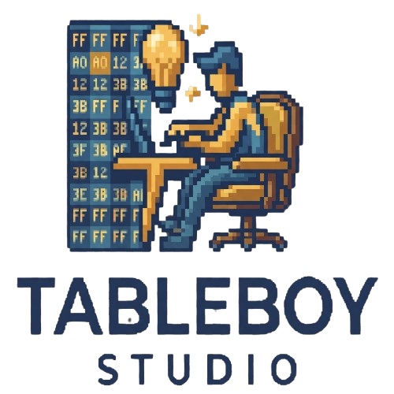

<p align="center">
  
</p>

# TableBoy Studio

Editor desktop de tabelas de caracteres `.tbl`, com matriz hexadecimal e suporte
a tabelas de 8 e 16 bits. A versão 1.5.0 concentra o aplicativo na criação e edição
de tabelas. O código do ROM Tools foi preservado em um arquivo separado.

## Recursos

- Criar, abrir, editar, validar e salvar tabelas `.tbl` em UTF-8.
- Matriz 16 × 16; endereços `00–FF` em 8 bits e `0000–FFFF` em 16 bits.
- Detecção do modo ao abrir e navegação por páginas em tabelas de 16 bits.
- Caracteres Unicode, strings e tokens, editáveis na matriz ou no inspector.
- Catálogo de caracteres latinos, PT-BR, símbolos e conjuntos japoneses.
- Maiúsculas (A–Z), minúsculas (a–z) e números (0–9) preenchem automaticamente
  a sequência inteira a partir da célula selecionada, em uma única ação Undo/Redo.
- As demais categorias permitem escolher um caractere para a célula selecionada.
- Busca por endereço hexadecimal ou valor da tabela, validação e estatísticas.
- Undo/Redo, arrastar um arquivo `.tbl` para abrir e proteção de alterações ao
  criar, abrir ou fechar documentos.

O aplicativo começa com uma tabela vazia. Para criar uma tabela de 16 bits,
selecione **Table Mode → 16-bit** enquanto a tabela estiver vazia. Digite uma
página hexadecimal ou navegue pelas páginas presentes no documento.

Para inserir um alfabeto ou os números, clique com o botão direito na célula
inicial e escolha **Maiúsculas (A-Z)**, **Minúsculas (a-z)** ou **Números (0-9)**.
Entradas existentes exigem confirmação antes da substituição. Se a sequência não
couber até `FF` ou `FFFF`, nenhuma célula será alterada.

Arquivos misturando chaves de 8 e 16 bits, chaves maiores que dois bytes e
entradas inválidas são recusados com uma mensagem. O editor não converte
automaticamente arquivos ANSI/OEM ou Shift-JIS para UTF-8.

## Atalhos

| Ação                      | Atalho          |
| ------------------------- | --------------- |
| Nova tabela               | Ctrl+N          |
| Abrir                     | Ctrl+O          |
| Salvar                    | Ctrl+S          |
| Salvar como               | Ctrl+Shift+S    |
| Desfazer / refazer        | Ctrl+Z / Ctrl+Y |
| Buscar na tabela          | Ctrl+F          |
| Limpar célula selecionada | Delete          |
| Ajuda de atalhos          | F1              |

## Desenvolvimento e empacotamento

Requer Node.js com suporte a `--experimental-strip-types` e npm. A versão usada
para validar a entrega está no [relatório de produção](docs/PRODUCTION_VALIDATION.md).

```sh
npm ci
npm run dev
```

```sh
npm run typecheck
npm run lint
npm test
npm run build
npm run build:win
```

O instalador Windows e a pasta executável ficam em `dist/table-editor-1.5.0/`.
O pacote inclui somente os bundles de produção, metadados e dependências de
runtime; arquivos de desenvolvimento e o arquivo de backup ficam fora dele.
Os comandos de macOS e Linux permanecem disponíveis, mas esta entrega é validada
no Windows. Compilar um instalador não publica uma release.

## Créditos

Desenvolvido por Lucas Ineth. Inspirado conceitualmente no Table Manager 1.0 de
Hyllian, com implementação própria. Electron, React, TypeScript e Vite.
